 

<strong>MODELING PHYSICAL + OPERATIONAL SYSTEMS</strong>

  

 

---

## ⚡ Current coordinates

<code>LIVE STATUS // UNIVERSITY OF TEHRAN // ENGINEERING SCIENCE</code>

| | |
|---|---|
| **Studying** | BSc in Engineering Science, University of Tehran — expected July 2027 |
| **Researching** | Resource-aware edge perception, model conversion, profiling, and hardware/software constraints |
| **Teaching** | Signals and Systems, Advanced Programming, Engineering Economy, and PEL for Engineering |
| **Exploring** | Numerical modeling, discrete-event simulation, optimization, machine learning, and computer vision |

## 🧭 What I work on

My projects sit where software meets a physical or operational system. I enjoy defining the assumptions, building the model, checking the result, and explaining what the result does—and does not—show.

`numerical modeling` · `discrete-event simulation` · `optimization` · `machine learning` · `computer vision` · `embedded AI`

## 🗂️ Selected work

| Project | What it explores |
|---|---|
| [Bike-sharing demand forecasting](https://github.com/alawful/bike-sharing-demand-forecasting) | Chronological forecasting experiments, seasonal baselines, and demand patterns. |
| [Perovskite device modeling](https://github.com/alawful/perovskite-device-modeling) | Collaborative DEVSIM drift-diffusion experiments with explicit modeling limits. |
| [Computer vision coursework](https://github.com/alawful/computer-vision-coursework) | Image filtering, validation, segmentation, and frame-by-frame processing. |
| [Production planning models](https://github.com/alawful/production-planning-models) | Aggregate planning, workforce decisions, and transportation models in PuLP. |
| [Arena simulation studies](https://github.com/alawful/arena-simulation-studies) | Emergency-department, operating-room, flow-shop, and inventory-production models. |
| [Signals and systems labs](https://github.com/alawful/signals-and-systems-labs) | Seven MATLAB and Simulink assignments spanning correlation, coding, ODEs, and system response. |
| [Bicycle frame and material study](https://github.com/alawful/bicycle-frame-material-study) | Frame geometry, selected structural outputs, and a Python material-ranking exercise. |
| [HSPICE circuit studies](https://github.com/alawful/hspice-transient-circuits) | Compact circuit netlists covering first-order and op-amp transient behavior. |

<strong>⌁ Open the extended project archive</strong>

| Project | What it explores |
|---|---|
| [GAMS optimization exercises](https://github.com/alawful/gams-optimization-exercises) | Transportation, workforce scheduling, production planning, and sensitivity experiments. |
| [Two-echelon transport optimization](https://github.com/alawful/two-echelon-transport-optimization) | The same factory–silo–store integer model implemented in GAMS and Python/PuLP. |
| [Two-stage rocket model](https://github.com/alawful/two-stage-rocket-model) | Collaborative vertical-flight modeling with changing mass, thrust, gravity, and drag. |
| [Numerical methods in MATLAB](https://github.com/alawful/numerical-methods-matlab) | Iterative solvers, numerical differentiation, and ODE exercises. |
| [Computational statics](https://github.com/alawful/computational-statics) | Python and MATLAB calculations supporting equilibrium and mechanics exercises. |
| [Breast-cancer model comparison](https://github.com/alawful/breast-cancer-model-comparison) | An educational comparison of six scikit-learn classifiers. |
| [Handwritten digits with PCA](https://github.com/alawful/handwritten-digits-pca) | Dimensionality reduction and visualization of handwritten-digit structure. |

## 🔬 Research notes

<code>RESEARCH MODE // WORKING REPOSITORIES ≠ FINAL MANUSCRIPTS</code>

- **Bike-sharing demand forecasting — manuscript under review.** I compared ridge regression, histogram-based gradient boosting, and seasonal baselines for Washington, D.C. and Seoul across several forecast horizons.
- **Perovskite solar-cell modeling — collaborative manuscript under review.** My contribution centered on DEVSIM simulations of penetration and passivation patterns, component checks, mesh refinement, and maximum-power comparisons.

The linked repositories are working-code archives, not copies of the manuscripts. They intentionally distinguish numerical experiments from measured evidence and state important limitations.

## 🛠️ Technical toolbox

  

## 🎓 Beyond the code

- Research assistant since 2025, working with Raspberry Pi, Coral hardware, INT8 TensorFlow Lite conversion, inference profiling, and edge-perception constraints.
- Teaching assistant at the University of Tehran across programming, engineering economy, signals and systems, and PEL for Engineering.
- Full undergraduate scholarship recipient; ranked **908th among more than 400,000 candidates** in Iran's national mathematics and physics university entrance examination.
- Persian native speaker; English, intermediate Arabic, and beginner French.

## 🧪 Publishing protocol

- State the question and my contribution.
- Keep runnable code or original model files when they can be shared.
- Remove student identifiers, submitted reports, transcripts, and collaborators' personal information.
- Separate measured results from numerical experiments.
- Note missing data, assumptions, dependencies, and limitations.
- Credit collaborative work without publishing teammates' personal information.

## 📡 GitHub snapshot

<code>LIVE PUBLIC-REPOSITORY SIGNAL</code>

 

 

 

---

### Open to conversations about intelligent systems, simulation, optimization, and interdisciplinary engineering research.

**Best contact:** [ali.owlia@ut.ac.ir](mailto:ali.owlia@ut.ac.ir)

<code>END OF TRANSMISSION // KEEP BUILDING</code>

