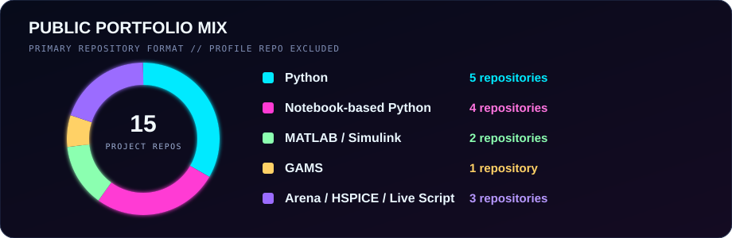

 

<strong>MODELING PHYSICAL + OPERATIONAL SYSTEMS</strong>

  

 

---

## ⚡ Current coordinates

<code>LIVE STATUS // UNIVERSITY OF TEHRAN // ENGINEERING SCIENCE</code>

| | |
|---|---|
| **Studying** | BSc in Engineering Science, University of Tehran — expected July 2027 |
| **Researching** | Resource-constrained edge perception with the UTCar autonomous-driving team |
| **Teaching** | Signals and Systems, Advanced Programming, Engineering Economy, and PEL for Engineering |
| **Exploring** | Numerical modeling, discrete-event simulation, optimization, machine learning, and computer vision |

## 🏎️ UTCar — building autonomy under real constraints

**Research Assistant · [UTCar on LinkedIn](https://www.linkedin.com/company/utcar/) · [University of Tehran](https://www.linkedin.com/school/university-of-tehran/) · 2025–present**

UTCar is the University of Tehran's autonomous-driving lab within the NOC Laboratory at the Faculty of Electrical and Computer Engineering. The team is developing a self-driving research vehicle and working across the autonomy stack: **decision-making, computer vision, sensor integration, simulation, embedded hardware, and vehicle actuation**. This means connecting algorithms to a physical platform and testing how perception, computation, electronics, and motion behave together.

For me, UTCar has been a central part of my engineering education. It is where machine-learning models meet limited computing resources, legacy software, cameras, electronics, and motors—and where a problem in one subsystem can affect the behavior of the entire vehicle.

**My work has focused on embedded perception and hardware–software integration:**

- Adapted **MobileNetV2/U-Net lane-segmentation models** for INT8 TensorFlow Lite deployment and profiled latency and TPU/CPU operator placement.
- Investigated operator and runtime incompatibilities in the legacy **Coral Edge TPU** stack and reduced unnecessary Raspberry Pi-to-accelerator transfers.
- Worked on an **SSD MobileNetV2 detection pipeline** for vehicles, pedestrians, and traffic lights while accounting for edge memory and compute limits.
- Diagnosed motor underperformance under load by tracing the voltage loss to the **RC motor driver**, not the motor itself.

<code>AUTONOMOUS DRIVING // COMPUTER VISION // RASPBERRY PI // CORAL DEV BOARD // FISHEYE CAMERA // TFLITE INT8 // SYSTEM-LEVEL DEBUGGING</code>

This profile describes my own contribution and what I learned from the work. Team-owned repositories and internal UTCar material remain with the organization rather than being copied into my personal account.

Official links: [UTCar on LinkedIn](https://www.linkedin.com/company/utcar/) · [UTCar on GitHub](https://github.com/UT-Car) · [College of Engineering on LinkedIn](https://www.linkedin.com/company/uteng-university-of-tehran/)

## 🧭 What I work on

My projects sit where software meets a physical or operational system. I enjoy defining the assumptions, building the model, checking the result, and explaining what the result does—and does not—show.

`numerical modeling` · `discrete-event simulation` · `optimization` · `machine learning` · `computer vision` · `embedded AI`

## 🗂️ Selected work

| Project | What it explores |
|---|---|
| Bike-sharing demand forecasting *(private — manuscript under review)* | Chronological forecasting experiments, seasonal baselines, and demand patterns. Supporting code and materials are available by request. |
| Perovskite device modeling *(private — manuscript under review)* | Collaborative DEVSIM drift-diffusion experiments with explicit modeling limits. Supporting code and materials are available by request. |
| [Computer vision coursework](https://github.com/alawful/computer-vision-coursework) | Image filtering, validation, segmentation, and frame-by-frame processing. |
| [Production planning models](https://github.com/alawful/production-planning-models) | Aggregate planning, workforce decisions, and transportation models in PuLP. |
| [Arena simulation studies](https://github.com/alawful/arena-simulation-studies) | Emergency-department, operating-room, flow-shop, and inventory-production models. |
| [Signals and systems labs](https://github.com/alawful/signals-and-systems-labs) | Seven MATLAB and Simulink assignments spanning correlation, coding, ODEs, and system response. |
| [Bicycle frame and material study](https://github.com/alawful/bicycle-frame-material-study) | Frame geometry, selected structural outputs, and a Python material-ranking exercise. |
| [HSPICE circuit studies](https://github.com/alawful/hspice-transient-circuits) | Compact circuit netlists covering first-order and op-amp transient behavior. |

<strong>⌁ Open the extended project archive</strong>

| Project | What it explores |
|---|---|
| [GAMS optimization exercises](https://github.com/alawful/gams-optimization-exercises) | Transportation, workforce scheduling, production planning, and sensitivity experiments. |
| [Two-echelon transport optimization](https://github.com/alawful/two-echelon-transport-optimization) | The same factory–silo–store integer model implemented in GAMS and Python/PuLP. |
| [Two-stage rocket model](https://github.com/alawful/two-stage-rocket-model) | Collaborative vertical-flight modeling with changing mass, thrust, gravity, and drag. |
| [Numerical methods in MATLAB](https://github.com/alawful/numerical-methods-matlab) | Iterative solvers, numerical differentiation, and ODE exercises. |
| [Computational statics](https://github.com/alawful/computational-statics) | Python and MATLAB calculations supporting equilibrium and mechanics exercises. |
| [Breast-cancer model comparison](https://github.com/alawful/breast-cancer-model-comparison) | An educational comparison of six scikit-learn classifiers. |
| [Handwritten digits with PCA](https://github.com/alawful/handwritten-digits-pca) | Dimensionality reduction and visualization of handwritten-digit structure. |

## 🔬 Research notes

<code>RESEARCH MODE // MANUSCRIPTS UNDER REVIEW // ACCESS BY REQUEST</code>

- **Bike-sharing demand forecasting — manuscript under review.** I compared ridge regression, histogram-based gradient boosting, and seasonal baselines for Washington, D.C. and Seoul across several forecast horizons.
- **Perovskite solar-cell modeling — collaborative manuscript under review.** My contribution centered on DEVSIM simulations of penetration and passivation patterns, component checks, mesh refinement, and maximum-power comparisons.

The manuscripts, supporting code, and research materials are private while the papers are under review. Access may be requested for legitimate academic or research purposes by emailing [ali.owlia@ut.ac.ir](mailto:ali.owlia@ut.ac.ir).

## 🛠️ Technical toolbox

  

## 🎓 Beyond the code

- Research assistant since 2025, working with Raspberry Pi and Coral hardware, INT8 TensorFlow Lite conversion, inference profiling, and resource-constrained edge perception.
- Teaching assistant at the University of Tehran for Advanced Programming, Engineering Economy, Signals and Systems, and PEL for Engineering.
- Recipient of a full undergraduate scholarship; ranked **908th among more than 400,000 candidates** in Iran's national mathematics and physics university entrance examination.
- Languages: Persian (native), English (working proficiency), Arabic (intermediate), and French (beginner).

## 🧪 Publishing protocol

- State the question and my contribution.
- Keep runnable code or original model files when they can be shared.
- Keep manuscript code and supporting materials private during peer review; provide access only by request when appropriate.
- Remove student identifiers, submitted reports, transcripts, and collaborators' personal information.
- Separate measured results from numerical experiments.
- Note missing data, assumptions, dependencies, and limitations.
- Credit collaborative work without publishing teammates' personal information.

## 🧬 Portfolio composition

<code>WHAT THE PROJECT ARCHIVE CONTAINS // NOT A PROFICIENCY SCORE</code>

 

 

---

### Open to conversations about intelligent systems, simulation, optimization, and interdisciplinary engineering research.

**Best contact:** [ali.owlia@ut.ac.ir](mailto:ali.owlia@ut.ac.ir)

<code>END OF TRANSMISSION // KEEP BUILDING</code>

